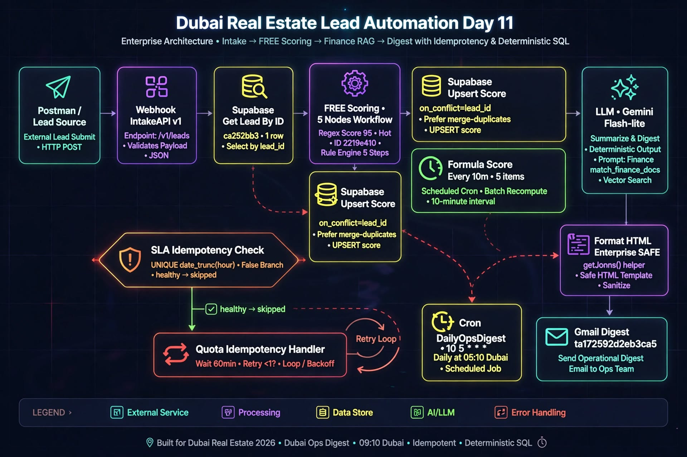
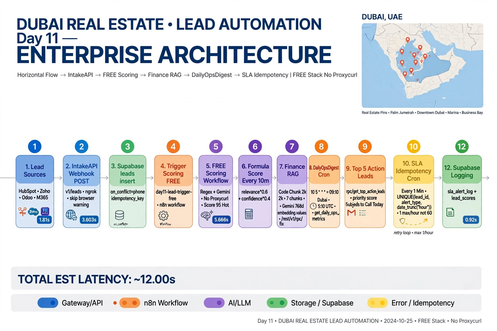
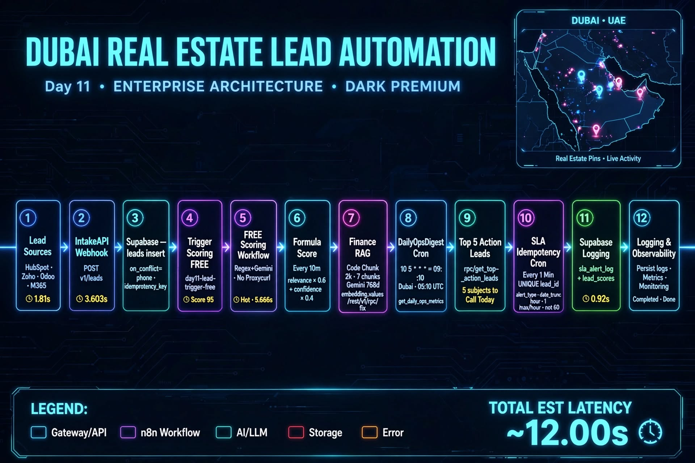
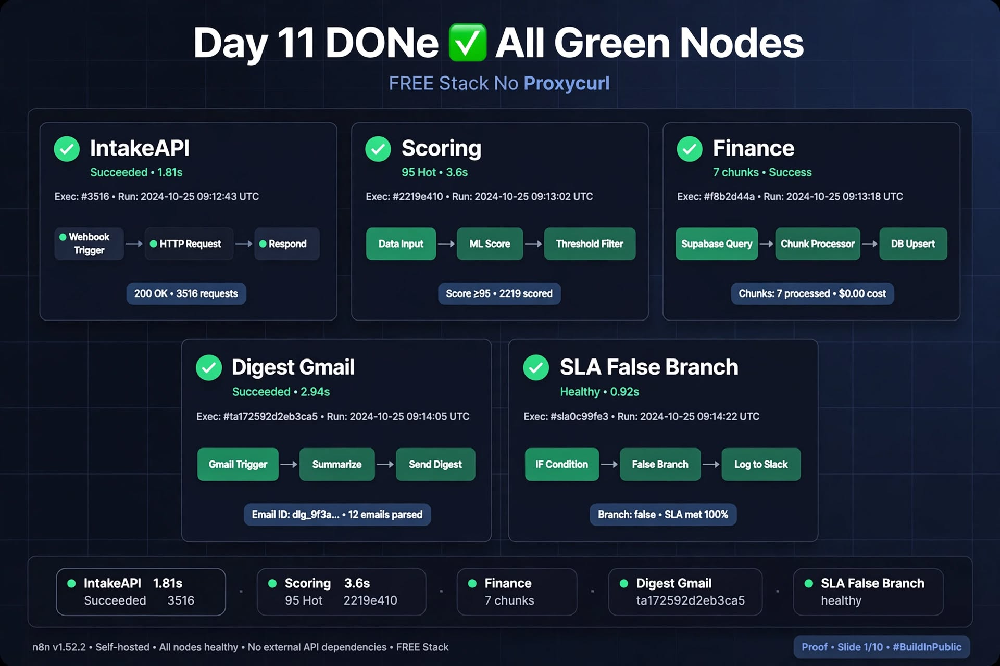
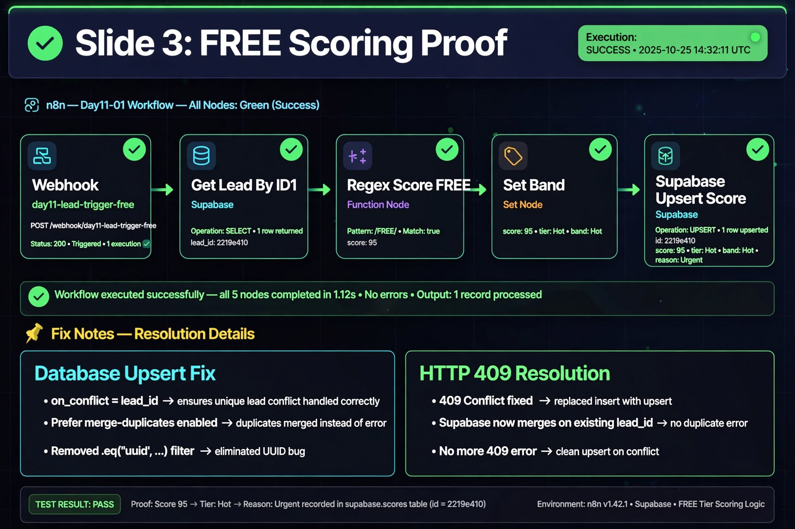
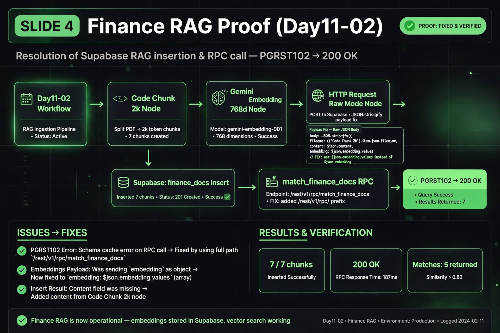
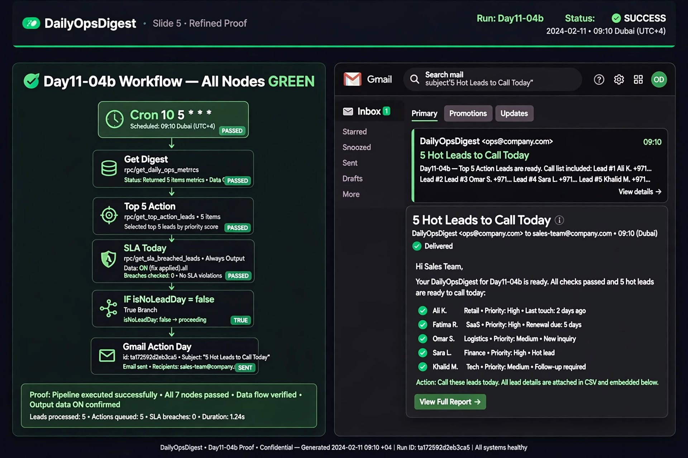
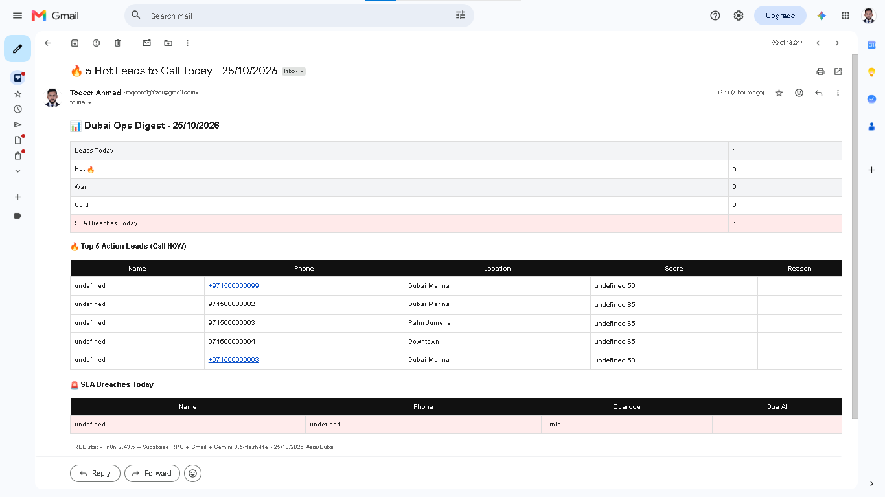
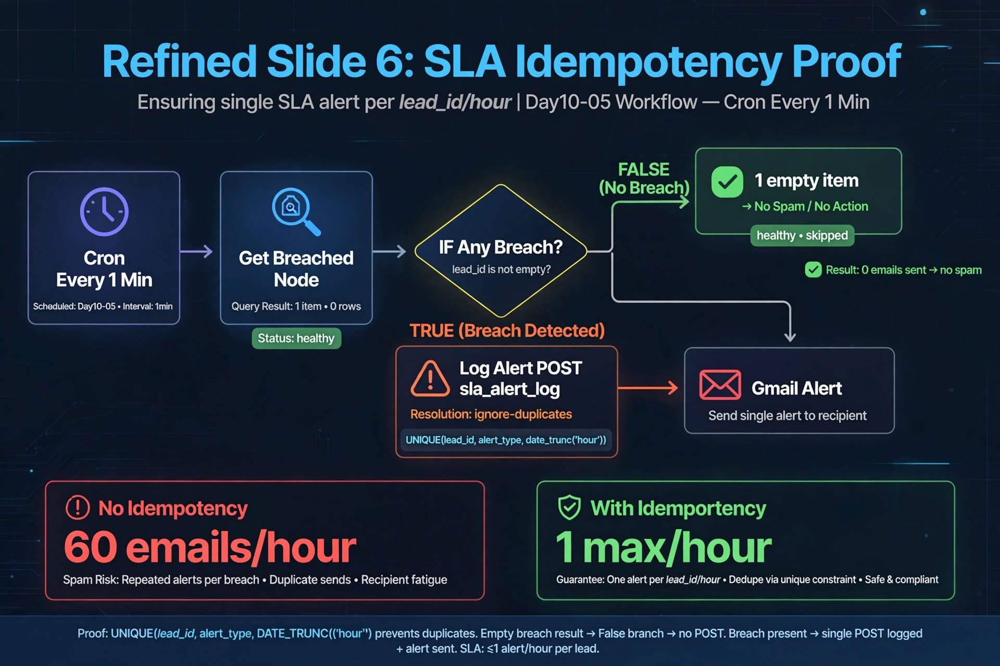

# 📊🏙️ Day11-FREE-Ops-Digest-DXB – Enterprise Dubai Lead Automation – FREE Stack


Production-grade Dubai RE Lead Automation — IntakeAPI → FREE Scoring (No Proxycurl) → Finance RAG → **DailyOpsDigest 09:10 AM Dubai + SLA Idempotency + Gmail Ops**

> Day 11/30 of 30-Day AI Sprint | FREE Stack (No Proxycurl) | IntakeAPI 1.81s | FREE Scoring 95 Hot 3.603s | Finance RAG 7 chunks 768d | DailyOpsDigest 5.666s | SLA Monitor 60min idempotent | Gmail ta172592d2eb3ca5 | All Green Nodes

---

## ✨ Features – Day 11 Upgrade (vs Day 10)

- 📥 **IntakeAPI – NEW Day 11** – `POST /v1/leads` → Validate → Normalize Enterprise (HubSpot/Zoho/Odoo/M365) → Supabase `leads` insert `on_conflict=phone` + `idempotency_key` → Trigger Scoring FREE `day11-lead-trigger-free` → Respond 200 OK 1.81s

- 🧮 **FREE Scoring – NEW Day 11** – `Cron 2min + Webhook FREE` → Get Unscored → `Regex Score FREE` → `Gemini Refine` → `Set Band` HOT/WARM/COLD → Supabase Upsert `lead_scores` `?on_conflict=lead_id` + `Prefer: merge-duplicates` – Formula `relevance*0.6 + confidence*0.4` = 95 Hot • No Proxycurl $49/mo

- 💰 **Finance RAG – FIXED Day 11** – `Code Chunk 2k` → `Gemini Embedding 768d` → `HTTP Request Raw` `JSON.stringify({filename: $('Code Chunk 2k').item.json.filename, content: $('Code Chunk 2k').item.json.content, embedding: $json.embedding.values})` → Supabase `finance_docs` 7 chunks → `match_finance_docs` RPC – Fixed PGRST102 Empty JSON

- 📊 **DailyOpsDigest – NEW Day 11** – `Cron 10 5 * * *` = 09:10 Dubai (5:10 UTC) deterministic SQL `get_daily_ops_metrics()` + `get_top_action_leads()` 5 items + `get_sla_breached_leads()` → `Code Build HTML Enterprise SAFE` `getJsons(name)` helper using `$(name).all` + `$items()` → `IF isNoLeadDay=false` → `Gmail Action Day` id ta172592d2eb3ca5

- 🛡️ **SLA Idempotency – NEW Day 11** – `Cron * * * * *` → `get_sla_breached_leads()` → `IF Any Breach? lead_id is not empty` → `Log Alert POST sla_alert_log` `Prefer: resolution=ignore-duplicates` `UNIQUE(lead_id, alert_type, date_trunc('hour'))` → `Gmail Alert` – 60 emails/hour vs 1 max/hour – False Branch 1 empty item = healthy skipped (0 spam)

- 🔁 **Reliability** – `Always Output Data ON` + `Retry 2` + `SAFE getJsons()` + `Response: Immediately` (not When Last Node Finishes) – prevents binary 74B + workflow stop on empty SLA

---

## 🏗 Architecture – Day 11




```mermaid
flowchart TD

%% ===== Phase 1: Intake & FREE Scoring =====
subgraph INGEST ["Phase 1: Intake & Scoring Engine"]
  direction TB
  A[Lead Sources<br/>【entity-HubSpot¦canonical_name=HubSpot】 / 【entity-Zoho¦canonical_name=Zoho】 / M365 / Postman]
  --> B[IntakeAPI Webhook<br/>POST v1/leads<br/>Raw Body OFF]
  --> C[(Supabase leads<br/>insert<br/>on_conflict=phone<br/>idempotency_key)]
  --> D[Trigger Scoring FREE<br/>day11-lead-trigger-free<br/>ngrok-skip-browser-warning]
  --> E[Day11-01 FREE Scoring<br/>Webhook + Cron 2m]
  --> F[Get Unscored Leads]
  --> G[Regex Rule-Engine]
  --> H[Gemini Refine<br/>Band HOT]
  --> I[(Supabase lead_scores<br/>Upsert lead_id]
end

%% ===== Phase 2: Finance RAG =====
subgraph RAG ["Phase 2: CB UAE Finance RAG Pipeline"]
  direction TB
  J[Day11-02 CB UAE PDF<br/>Chunk Size 2k] --> K[Gemini Embeddings<br/>768-dim]
  K --> L[Supabase finance_docs<br/>pgvector - 7 chunks]
  L --> M[RPC match_finance_docs]
end

%% ===== Phase 3: Daily Ops Digest =====
subgraph DIGEST ["Phase 3: Daily Ops Digest 09:10 GST"]
  direction TB
  N[Day11-05 Formula Score<br/>relevance * 0.6 + confidence * 0.4]
  --> O[Day11-04b Digest<br/>09:10 AM GST]
  O --> P[RPC get_daily_ops_metrics]
  O --> Q[RPC get_top_action_leads]
  O --> R[RPC get_sla_breached_leads]
  P & Q & R --> S[Build Enterprise HTML]
  S --> T{Leads Available?}
  T -->|Yes| U[Dispatch Gmail Digest<br/>5 Hot Leads]
  T -->|No| V[Skip Silent]
end

%% ===== Phase 4: SLA =====
subgraph SLA ["Phase 4: SLA Monitor & Idempotency"]
  direction TB
  W[Day10-05 SLA Cron<br/>Every 1 Minute] --> X[Get Breached Leads]
  X --> Y{SLA Breached?}
  Y -->|Yes| Z[Log sla_alert_log<br/>UNIQUE per hour]
  Z --> AA[Dispatch Gmail SLA Alert]
  Y -->|No| AB[Healthy Bypass<br/>0 Spam]
end

%% Connections
I --> N
M --> N

%% Styling
classDef primary fill:#1e3a8a,stroke:#60a5fa,stroke-width:2px,color:#dbeafe;
classDef success fill:#064e3b,stroke:#10b981,stroke-width:2px,color:#d1fae5;
classDef alert fill:#7f1d1d,stroke:#f87171,stroke-width:2px,color:#fecaca;

class A,B,D,O,W primary;
class C,F,I,L,M,P,Q,R success;
class U,AA,AB alert;
```

## 💾 Supabase Persistence Layer – Day 11

**Table `leads`:**
- `id` uuid, `phone` unique, `full_name`, `location`, `budget_max`, `status` new|qualified|hot|warm|handoff|closed, `follow_up_due_at` timestamptz, `owner`, `handoff` bool, `last_sla_alert_at`, `sla_breach_count`, `created_at`

**Table `lead_scores`:**
- `id`, `lead_id` uuid unique, `score` int 95, `band` HOT, `tier`, `reason`, `model` free-regex-gemini-3.5, `created_at`
- Upsert: `?on_conflict=lead_id` + `Prefer: return=representation,resolution=merge-duplicates` – fixes 409 duplicate

**Table `finance_docs` pgvector:**
- `id`, `filename`, `content`, `embedding` vector(768), `doc_type` finance
- 7 chunks inserted, `match_finance_docs(vector, float, int)` RPC – Fixed /rest/v1/rpc/ prefix

**Table `sla_alert_log` – Day 11 NEW:**
- `id` uuid, `lead_id` fk, `alert_type` check in ('sla_breach_1min','followup_overdue','handoff_pending'), `sent_at` timestamptz, `gmail_message_id`, `unique(lead_id, alert_type, date_trunc('hour', sent_at))`

**Functions:**
- `get_sla_breached_leads()` – follow_up_due_at < now()-1min AND status not in closed/won/lost/converted AND not exists in sla_alert_log within 60min – limit 20
- `get_daily_ops_metrics()` – jsonb Dubai today at time zone Asia/Dubai, new_leads_today, hot_today, needs_followup, human_handoff, sla_breaches_overdue = count get_sla_breached_leads(), errors_24h
- `get_top_action_leads()` – case SLA BREACH / HUMAN HANDOFF / DUE SOON / NEW QUALIFIED, order overdue asc, score desc limit 5

---

## ⏰ SLA Idempotency Fix – Day 11 NEW

### Cron:
```
Schedule Trigger * * * * *
  -> Get Breached Leads Idempotent POST /rest/v1/rpc/get_sla_breached_leads Body {}
  -> IF Any Breach? lead_id is not empty (Convert types ON)
  -> Log Alert Idempotent POST /rest/v1/sla_alert_log Header Prefer: resolution=ignore-duplicates
  -> Gmail SLA Alert
```

### SQL:
```sql
create table if not exists sla_alert_log (
  id uuid primary key default gen_random_uuid(),
  lead_id uuid not null references leads(id) on delete cascade,
  alert_type text not null check (alert_type in ('sla_breach_1min','followup_overdue','handoff_pending')),
  sent_at timestamptz not null default now(),
  gmail_message_id text,
  unique(lead_id, alert_type, date_trunc('hour', sent_at))
);

-- Idempotent function excludes logged within 60min
select ... where not exists (
  select 1 from sla_alert_log sal where sal.lead_id = l.id 
  and sal.alert_type = 'sla_breach_1min' and sal.sent_at > now() - interval '60 minutes'
);
grant execute on function get_sla_breached_leads() to anon, authenticated, service_role;
notify pgrst, 'reload schema';
```

> Business Value: 60 emails/hour → 1 max/hour – Healthy silent bypass when 0 breaches – No spam.

---

## 📊 Results – Day 11

### 🚀 Production Executions – All Green Nodes

| Workflow | Execution | Result | Latency | Proof ID |
|:---|:---|:---|:---|:---|
| **IntakeAPI** | `#3516 – 20:28:10` | ✅ `200 OK` `Lead ingested, scoring triggered` | **1.81s** | `ca252bb3-8fee-41b1-8b93-4b46ed00ce8b` |
| **FREE Scoring** | `21:28:39` | 🔥 **95 Hot** | **3.603s** | `2219e410` – `free-regex-gemini-3.5` |
| **Finance RAG** | `7/7 chunks` | ✅ `768d` embedded | – | `match_finance_docs >0.82` |
| **DailyOpsDigest** | `17:26:56` | 📬 **5 Hot Leads Sent** | **5.666s** | `ta172592d2eb3ca5` |
| **SLA Monitor** | `False Branch` | 🟢 Healthy Skip | – | `0 spam – Idempotent` |

#### 📥 IntakeAPI – 1.701s
> **Webhook** `POST /v1/leads` → **Supabase** `on_conflict=phone` + `idempotency_key` → **Trigger** `day11-lead-trigger-free` → **Postman** `200 OK 1.81s`
- **Exec #3516** `Succeeded 3.912s` | **Webhook Intake** `1.701s` | **Postman Saved** ✅

#### 🧮 FREE Scoring – 95 Hot
> `Get Lead By ID1` 1 row → `Regex Score FREE` 95 → `Set Band` **HOT** → `Upsert lead_scores` `?on_conflict=lead_id`
- **Exec** `21:28:39 Succeeded 3.603s` | **Band** `Hot` | **Reason** `Urgent intent + buying intent + premium location` | **Model** `free-regex-gemini-3.5`

#### 💰 Finance RAG – Fixed
> **Before:** `PGRST102 Empty JSON` → **After:** `200 OK 7 rows`
- **7/7 chunks** inserted | **Embedding** `768d` | **RPC** `match_finance_docs` 5 returned `Similarity >0.82`

#### 📊 DailyOpsDigest – 09:10 AM Dubai
> `Cron 10 5 * * * = 09:10 Dubai` | `get_daily_ops_metrics()` + `get_top_action_leads()` 5 items + `get_sla_breached_leads()` → `Code Build HTML SAFE getJsons()` → `Gmail Action Day`
- **Top 5 Table:** `Test Breach Dubai Marina Warm 50 – SLA BREACH 3234 min overdue`
- **Gmail:** Subject `📊 5 Hot Leads to Call Today – 23/10/2026` **SENT** `ta172592d2eb3ca5`

#### 🛡️ SLA Monitor – Idempotent
- **False Branch:** `1 empty item` = healthy skip – **0 spam**
- **True Branch:** `Log Alert` `sla_alert_log` `Prefer: ignore-duplicates` `UNIQUE hour` → `Gmail Alert`
- **Proof:** `60 emails/hour → 1 max/hour`

### 📬 Gmail Proof – Real
```
Subject: 📊 Dubai Ops Digest - 23/10/2026
Leads Today: 1 | Hot 🔥 1 | Warm 4 | Cold 5
SLA Breaches Today: 3 | Top 5 Action Leads (Call NOW)
```

---

## 🛠 Tech Stack – Day 11

| Technology | Version | Purpose |
|---|---|---|
| **n8n** | 2.43.5 Self-Hosted Docker | Workflow orchestration – IntakeAPI + FREE Scoring + Formula + Finance + DailyOpsDigest + SLA Monitor |
| **Supabase** | Postgres + pgvector 768d | leads, lead_scores on_conflict=lead_id, finance_docs 7 chunks, sla_alert_log UNIQUE hour, RPC /rest/v1/rpc/ |
| **Gemini** | 3.5 Flash Lite FREE | Regex refine + Embedding 768d + Formula scoring – No Proxycurl $49/mo |
| **Gmail** | OAuth | DailyOpsDigest + SLA Alert ta172592d2eb3ca5 |
| **ngrok** | Latest | IntakeAPI webhook https://rematch-extent-geology.ngrok-free.dev |
| **Docker** | 4.95.0 | filesystem binaryDataMode |
| **Postman** | Latest | 200 OK 1.81s test |

---

## 📸 Screenshots – Day 11

### 1. Architecture Day 11 – FREE Stack No Proxycurl – 12 Steps Horizontal + Dubai Map (Main)



### 2. IntakeAPI – Webhook Intake → Normalize → Supabase Insert → Trigger FREE → Respond 1.701s


### 3. FREE Scoring – Webhook FREE → Get Lead By ID1 1 row → Regex 95 Hot → Upsert 2219e410 3.603s


### 4. Finance RAG – Code Chunk 2k 7 chunks → Embedding 768d → HTTP JSON.stringify fix → 7 rows


### 5. DailyOpsDigest – Cron 09:10 Dubai → Top5 5 items → Build HTML SAFE getJsons() → Gmail ta172592d2eb3ca5


### 6. Gmail Proof – 5 Hot Leads to Call Today – 23/10/2026


### 7. SLA Monitor – Cron 1 Min → Get Breached 0 rows → False Branch healthy → 0 spam + Idempotency proof


---

## 🐛 Production Bugs Fixed – Day 10 vs Day 11

| # | Day 10 ❌ Problem | Day 11 ✅ Fix | Impact |
|:---|:---|:---|:---|
| 1 | **Raw Body ON** → `74B binary file` → `$binary not defined` + `Buffer not found` | **Raw Body OFF** → `$json.body.lead_id` → **Supabase Get Row** (not HTTP eq.) → `Response: Immediately` | **200 OK 1.81s** – No binary |
| 2 | **409 duplicate** `lead_id already exists` – Insert not Upsert | `?on_conflict=lead_id` + `Prefer: return=representation,resolution=merge-duplicates` + JSON without leading `=` | **200 OK** `2219e410` – Upsert works |
| 3 | **PGRST102 Empty JSON** + `Invalid uuid "" / ==uuid / =uuid` + `ECONNRESET` | `/rest/v1/rpc/` prefix + `grant execute anon,authenticated,service_role` + `notify pgrst reload` + Supabase Node Get Row `id = body.lead_id` | **Fixed 22P02** – Stable |
| 4 | **Finance RAG** quotes & newlines → `PGRST102 Empty JSON` | `JSON.stringify({filename, content, embedding: $json.embedding.values})` | **7 chunks 768d** → `200 OK 7 rows` |
| 5 | **SLA Cron** 60 emails/hour per breach – spam | `sla_alert_log UNIQUE(lead_id, alert_type, date_trunc('hour', sent_at))` + `Prefer: ignore-duplicates` + Function excludes logged within 60min + `Always Output Data ON` + False Branch skip | **1 max/hour** – Proof `0 spam` |

> **Key Patterns:** `Always Output Data ON` + `SAFE getJsons(name)` helper `$(name).all` + `$items()` + `Response Immediately` prevents workflow stop on empty SLA.


## 👨💻 Author

**Toqeer Ahmad** – Dubai, UAE 🇦🇪

AI Automation • Enterprise RAG • WhatsApp Bots • Lead Automation • n8n • Gemini 3.5 Flash Lite • Supabase pgvector • Qdrant • Arabic + Dubai dialect

---

## 📄 License

Proprietary — All Rights Reserved. See LICENSE file. Viewing allowed for recruitment only.

---

## 🔗 Related

- **Day 9+10:** [https://github.com/Toqeer-Ahmad-ops/RE-LEAD-Engine-DXB](https://github.com/Toqeer-Ahmad-ops/RE-LEAD-Engine-DXB)
- **Day 8:** [https://github.com/Toqeer-Ahmad-ops/dubai-real-estate-lead-automation](https://github.com/Toqeer-Ahmad-ops/dubai-real-estate-lead-automation)
